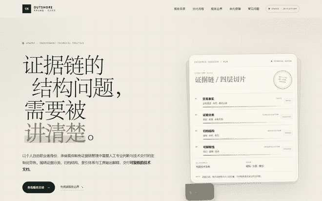
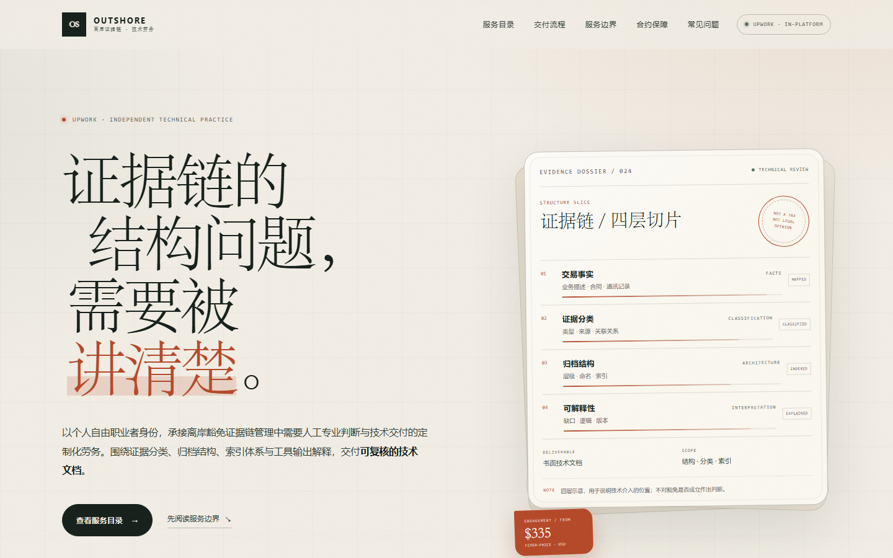
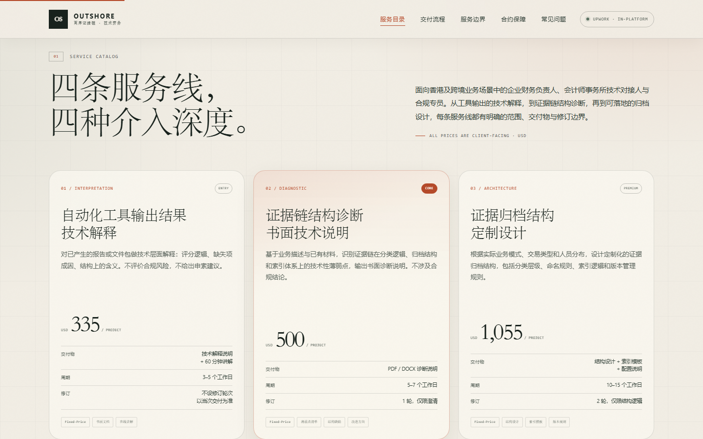

# OUTSHORE · 离岸证据链技术劳务（Upwork）

面向 Upwork 作品集展示的独立服务页：**单文件 HTML，零外部依赖，全部内容离线可运行。**

> 正在准备离岸豁免申请的公司，通常已经有一批合同、发票、邮件和工具输出，
> 却说不清这些材料在结构上是否支撑得住在岸 / 离岸的事实叙述。
> 这个页面把"证据链技术梳理"讲成一件可报价、可交付、可复核的劳务，
> 而不是一份税务意见。

---

## 客户故事

一位在香港注册公司的内地创始人，准备递交离岸豁免申请。财务和顾问反复问同一个问题：
**"这些材料能证明业务不在香港发生吗？"** 公司有合同、有发票、有自动化工具生成的报告，
但没有人能把这些东西在"分类—归档—索引—可解释性"四个层面上讲清楚。
本页面对应的劳务只做其中技术性的一层：识别证据链的结构性薄弱点、设计归档与索引结构、
解释工具输出结果。是否申索、如何申索，交回给持牌税务顾问与律师。

**English summary** — OUTSHORE is a single-page, dependency-free service site for a
freelancer offering *technical* offshore evidence-chain work on Upwork: structural
diagnosis, archive/index design, and tool-output interpretation. It is not tax, legal,
or accounting advice, and it does not determine whether an offshore exemption claim is
valid.

---

## 页面演示

首屏交互（GIF，约 15 秒）：首屏 → 服务目录 → 核心服务卡悬停 → 服务边界 →
免责声明 → 常见问题展开 → 收尾区块。

- 静态截图：`assets/screenshot-hero.png`、`assets/screenshot-catalog.png`、`assets/screenshot-scope.png`
- 页面源文件：[`index.html`](index.html)

展开静态截图

| 首屏 | 服务目录 |
| --- | --- |
|  |  |

---

## 适合 / 不适合

**适合**

- 在香港或跨境场景中运营、正在准备离岸豁免申请，或需要复核现有证据链结构的公司负责人
- 已被自动化工具（评分、清单、报告生成器）产出结果、需要有人解释"这些结果在技术上意味着什么"的财务与合规人员
- 需要给客户或内部团队一套可落地的归档 / 索引结构的技术对接人

**不适合**

- 需要税务、法律或会计意见，或需要"能不能申索"的结论
- 需要代理申报、与税务机关沟通，或标准化清单核对、自动评分、文件导出
- 希望绕开 Upwork 平台完成沟通、合约或付款

---

## 四条服务线

| 服务线 | 交付物 | 周期 | 修订 | 价格 |
| --- | --- | --- | --- | --- |
| `01 / INTERPRETATION` 自动化工具输出结果技术解释 | 技术解释说明 + 60 分钟讲解 | 3–5 个工作日 | 不设修订轮次 | **USD 335** / project |
| `02 / DIAGNOSTIC` 证据链结构诊断（书面技术说明） | PDF / DOCX 诊断说明 | 5–7 个工作日 | 1 轮，仅限澄清 | **USD 500** / project |
| `03 / ARCHITECTURE` 证据归档结构定制设计 | 结构设计 + 索引模板 + 配置说明 | 10–15 个工作日 | 2 轮，仅限结构逻辑 | **USD 1,055** / project |
| `04 / ADVISORY_RETAINER` 限定范围技术顾问 | 按小时顾问支持（自动追踪计费） | 最低 2 周起 | — | **USD 65** / hour，每周不超过 8 小时 |

> 页面所列为客户面对价格；具体以 Upwork 提案与 offer 为准。

---

## 技术实现

- **单文件**：`index.html` 内联全部 CSS 与 JavaScript，无构建步骤、无框架、无网络请求。
- **零依赖**：不加载字体、图标库、分析脚本或任何第三方资源；`file://` 直接打开即可运行。
- **响应式**：桌面、平板、移动端三档布局；导航在窄屏折叠为菜单。
- **可访问性**：语义化 `<section>` / `<h2>` 结构，`aria-labelledby` 关联区块标题，跳转链接全部为页面内锚点，动画尊重 `prefers-reduced-motion`。
- **交互**：滚动进度条、当前区块高亮（scroll-spy）、`IntersectionObserver` 渐显、FAQ 手风琴（原生 `
`）。

页面中所有价格、服务边界与合规声明以文件内容为准；本仓库不修改它们。

---

## 合规边界与免责声明

本服务仅提供证据链管理相关的技术性梳理与结构设计，不构成税务、法律或会计意见，不判定离岸豁免是否成立。
所有涉及合规判断的事项，应由持牌税务顾问或律师作出。

---

## Upwork 站内沟通

所有沟通、合约、交付与付款均在 Upwork 平台内完成；本页面不提供站外联系方式，不引导站外交易。
项目启动前先确认范围与合约类型（固定价格里程碑或按小时合约）。

---

## 来源仓库 · Source repositories

本仓库是一个独立演示，除 `index.html`（`outshore` 页面源文件的逐字副本）外，**不包含**下列仓库的代码或数据。它们同属香港公司 / 离岸合规方向的项目集，作为本工具的上下文与来源登记在案（完整清单见 [`docs/SOURCES.md`](docs/SOURCES.md)）。

| 仓库（均为 private） | 角色 | 技术栈 | 与本品的关系 |
| --- | --- | --- | --- |
| `wanqushangpai-odoo` | 香港公司 Odoo 18 记账中台：SME-FRS 科目表、多币种流水采集、离岸豁免辅助核算 | Odoo 18 · Python · PostgreSQL · Docker | 账务与审计底稿来源；本工具的自检项与之对应 |
| `wanqushangpai-odoo-infra` | 上述中台的一键部署与运维 | Docker Compose · Nginx · Certbot | 部署层，与本工具无运行时依赖 |
| `group-sop` | 竞标 / 经纪 / PDF 解析引擎 | React 19 · TypeScript · Cloudflare Workers · D1 · R2 | 同一业务方向的工程样例 |
| `crypto-reconciliation-cleaner` | 离线加密交易对账清洗器（单文件） | 单文件 HTML/JS | 同一设计取向：零依赖、数据不出本机 |
| `outshore` | 离岸证据链技术劳务落地页 | 单文件 HTML/JS | 本仓库页面的直接来源：`index.html` 为 `outshore.html` 的逐字副本 |

> 以上仓库目前为私有，公开链接无法直接访问；如需演示或源码 walkthrough，请通过 [GitHub 主页](https://github.com/zhetai) 联系。本仓库除页面源文件外不复制它们的代码，也不含其客户或业务数据。

---

## License

[MIT](LICENSE) © 2026 OUTSHORE
